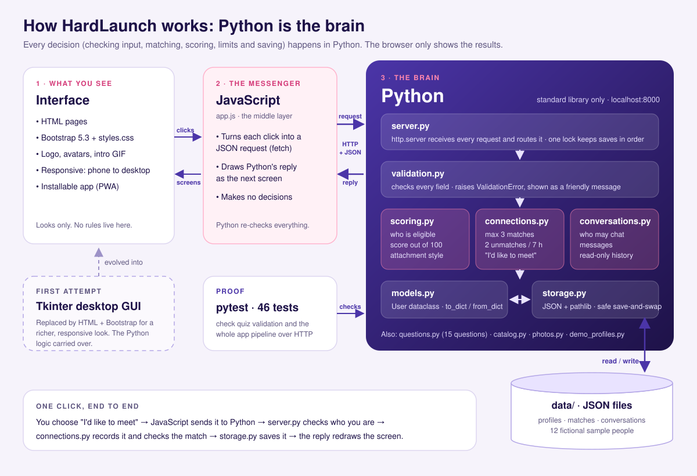
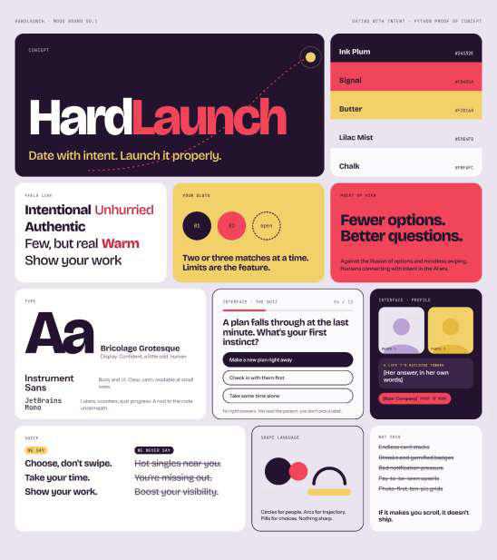

# HardLaunch

**Meet someone on your wavelength. Dating with intent.**


## About HardLaunch

Most dating apps are built to keep you swiping: endless profiles, unclear intentions
and matches that go nowhere. **HardLaunch is built for the opposite.** It is for adults
who know what they are looking for and would rather meet a few people properly than
scroll past hundreds.

How it works:

1. **Make it you.** Create a profile with an avatar or photo, your city, your
   interests, and who you would like to meet.
2. **Choose your intention:** a long-term relationship, casual dating or exploring
   connections. Only people with the same intention are introduced. People seeking
   something long-term take a short 15-question compatibility quiz and learn their
   attachment style.
3. **Meet your introductions.** You get up to three, each explaining what you share,
   with a ready-made icebreaker and, for long-term seekers, a compatibility score out
   of 100.
4. **Say hello when it is mutual.** Chat opens only when both people choose "I'd like
   to meet".

**What makes it different:** fewer options and better questions, by design.

- Everyone has at most three active matches.
- Unmatching is limited to two every seven hours, so each connection gets a real chance.
- Your relationship type can change only once a month.
- Every introduction explains itself, and blocking is always free.

HardLaunch is a COMP9001 proof of concept. It runs on one laptop, with fictional
sample people and no online accounts.

**Python is the brain of the project.** Every decision (checking input, deciding who
is eligible, scoring compatibility, enforcing limits and saving data) is made by the
`hardlaunch` Python package. The web interface only displays what Python decides.



**Contents:**
- [About HardLaunch](#about-hardlaunch)
- [1. Python: the brain](#1-python-the-brain)
- [2. Python concepts used](#2-python-concepts-used)
- [3. How the Python decides](#3-how-the-python-decides)
- [4. Run it](#4-run-it)
- [5. Tests](#5-tests)
- [6. The interface](#6-the-interface)
- [7. Data, privacy and limits](#7-data-privacy-and-limits)
- [8. API reference](#8-api-reference)
- [9. Project structure](#9-project-structure)
- [Credits](#credits)
- [AI Acknowledgement](#ai-acknowledgement)

---

## 1. Python: the brain

The project is about 2,000 lines of Python in `hardlaunch/`, plus about 640 lines
of tests. It uses **only the Python standard library**: no frameworks, no database
and no packages to install.

A request travels through the package like this:

1. **`server.py`** receives the request from the browser, works out which action it
   is and who is asking, and holds a lock so two saves never overlap.
2. **`validation.py`** checks every field. Anything wrong raises a `ValidationError`
   that becomes a friendly message beside the right field.
3. **The rule modules** decide:
   - `scoring.py` decides who is eligible, the compatibility score and the attachment style.
   - `connections.py` handles the three-match cap, the "I'd like to meet" consent, the unmatch allowance and blocking.
   - `conversations.py` decides who may chat and keeps the message history.
4. **`models.py`** holds the `User` class, and **`storage.py`** saves everything as
   JSON files in `data/`.
5. The reply goes back to the browser as JSON, and JavaScript draws the next screen.

The browser is never trusted to make a decision. If someone sent a request without the
interface (for example, claiming an extra unmatch), Python checks it again and refuses it.

| Module | What it does |
| --- | --- |
| `models.py` | `User` dataclass: one person's profile, with conversion to and from JSON |
| `storage.py` | Loads and saves JSON files safely with `pathlib` |
| `validation.py` | Checks every profile field; `ValidationError` |
| `questions.py` | The 15 quiz questions, their answer options and scoring direction |
| `catalog.py` | Fixed choices: cities, genders, intentions, interests, avatars |
| `scoring.py` | Eligibility filters, the score out of 100, explanations, attachment style |
| `connections.py` | Saved matches, "I'd like to meet", unmatching, blocking, monthly type changes |
| `conversations.py` | Starting conversations, sending messages, read-only history |
| `photos.py` | Checks uploaded photos: type, size and file signature |
| `demo_profiles.py` | Adds the ten fictional demo profiles |
| `server.py` | Standard-library HTTP server: routes, request checks, static files |

---

## 2. Python concepts used

COMP9001's advanced topics include classes and objects, file handling, error handling
and testing. HardLaunch uses each of them for a real purpose rather than as decoration.

| Concept | Where | How it is used |
| --- | --- | --- |
| **Classes and objects** | `models.py`, `server.py`, `validation.py`, `connections.py`, `conversations.py` | `User` is a `@dataclass` with `@property` values (`profile`, `values`) and a `@classmethod` (`from_dict`). `Handler` subclasses `BaseHTTPRequestHandler`. Custom exceptions `ValidationError`, `ConnectionError` and `ConversationError` extend `ValueError`. |
| **File handling** | `storage.py` | Reads and writes JSON with `with open`, `json` and `pathlib`. Each save writes a temporary file first, then swaps it in, so a crash never leaves a half-written file. |
| **Error handling** | `server.py`, `validation.py`, `photos.py` | `try` / `except` turns each error into the right HTTP status (422 invalid field, 409 stale profile, 429 no unmatches left) and a clear message. Unreadable data files are reported, never overwritten. |
| **Data structures** | `scoring.py`, `connections.py`, `questions.py` | Lists, dictionaries, sets, nested structures (quiz dimensions map to question lists; matches are saved as pairs), plus list and dictionary comprehensions. |
| **Functions and modules** | the whole package | Eleven focused modules with about 90 functions, each with one job, for example `eligible()`, `compatible()`, `reconcile()` and `quota()`. |
| **Concurrency** | `server.py` | `ThreadingHTTPServer` handles requests in parallel; an `RLock` makes matching, limit checks and file writes happen one at a time. |
| **Dates and times** | `connections.py` | `datetime`, `timezone` and `timedelta` run the rolling seven-hour unmatch window and the 30-day relationship-type lock. |
| **Standard library** | throughout | `http.server`, `json`, `pathlib`, `dataclasses`, `argparse`, `uuid`, `secrets`, `hashlib`, `base64`, `binascii`, `mimetypes`, `urllib.parse`, `threading`. |
| **Testing** | `tests/` | `pytest`: white-box tests of quiz validation and scoring (`test_scoring.py`), and black-box tests that send real HTTP requests through the whole app and check the saved data (`test_server.py`). |

**A class at the centre (`models.py`):**

```python
@dataclass
class User:
    id: str
    name: str
    age: int
    city: str = ""
    answers: dict = field(default_factory=dict)  # {question_id: 1..4}
    preferred_genders: list = field(default_factory=list)
    ...

    @property
    def profile(self):
        """Averaged 1..4 score per dimension."""
        return scoring.score(self.answers)

    @classmethod
    def from_dict(cls, data):
        ...
```

**Safe file handling (`storage.py`):**

```python
def write_json(data, path):
    """Write a complete replacement before replacing the previous JSON file."""
    path = Path(path)
    path.parent.mkdir(parents=True, exist_ok=True)
    temporary = path.with_suffix(".tmp")
    with temporary.open("w", encoding="utf-8") as f:
        json.dump(data, f, indent=2, ensure_ascii=False)
    temporary.replace(path)
```

---

## 3. How the Python decides

### Who can be introduced (`scoring.eligible`)

Two people are eligible only when **both** of these are true for each of them:

- They are complete adult profiles in the **same city**.
- Each one's gender is in the other's chosen preferences, and each one's age is in
  the other's age range (endpoints included).
- They chose the **same relationship intention**.
- For long-term relationships only: both finished all 15 questions, and their
  commitment scores are no more than one point apart.

Gender identity and preferences are separate (Woman, Man, Non-binary, Another identity,
with optional self-description). Names, free text and pronouns never affect eligibility.
The app never quietly widens anyone's preferences to fill empty places.

### The compatibility score (`scoring.compatible`, long-term only)

| Part | Points | How it is worked out |
| --- | --- | --- |
| Similarity | 60 | Six areas (sharing support, communication, changing plans, making plans, trying new things, relationship pace) each give `10 * (1 - gap / 3)` |
| Shared values | 20 | Questions 14 and 15 each add 10 when both people chose the same answer |
| Care fit | 20 | Checked both ways: someone who looks for reassurance (anxiety 2.5 or more) earns 10 with a giver (helping-others 3 or more), otherwise 5. Everyone else earns 10 |

Cards show a label instead of the number: **Strong common ground** (80+), **Good
common ground** (65–79) or **Worth exploring**. After the quiz, **Your wavelength**
shows the person's attachment style (Secure, Anxious, Avoidant or Fearful-avoidant,
from questions 1, 3 and 5). This measures answer similarity. It is a course-project
heuristic, **not a prediction of relationship success or a psychological assessment**.

**Casual dating** and **Exploring connections** skip the quiz. Shared interests rank
their introductions instead, and quiz answers are never used for them.

### Matches, consent and limits (`connections.py`)

- **At most three active matches per person.** `reconcile()` is the only place matches
  are made. It pairs people best-score first, in three rounds: first pairs that give
  both people their first match, then pairs that give one person their first match,
  then everyone else with room. That way nobody with an eligible partner is left with
  none. Ties are broken with a saved random seed, not by alphabetical order.
- **Matches are saved:** refreshing, restarting or adding profiles never replaces an
  existing match.
- **Chat opens only when both people choose "I'd like to meet".** Until then, one
  person's yes stays private.
- **Two unmatches in any rolling seven hours.** Each unmatch is replaced straight
  away when someone is available. Receiving an unmatch costs nothing. The server
  enforces this even for requests sent without the interface.
- **Block or report** is always free and never uses the allowance.
- **The relationship type can change once every 30 days,** after a confirmation
  screen. Changing it refreshes matches automatically without using an unmatch.
  Editing a profile in a way that would quietly end a match is refused.

### Checking input (`validation.py`, `photos.py`)

Every field is checked in Python, including requests not sent by the interface: text
lengths, whole-number ages from 18 to 99, valid choices, a completed quiz for long-term
profiles, and photos. Photos must be JPEG, PNG or WebP up to 2 MB. Python checks the
file signature, not just the name.

---

## 4. Run it

Requires **Python 3.10+**. Nothing else needs installing.

```powershell
python main.py
```

Open **http://localhost:8000** and keep the terminal running (Ctrl+C stops it). If
the port is busy, run `python main.py --port 8001` and use the printed address.

| Address | What it opens |
| --- | --- |
| http://localhost:8000 | The app |
| http://localhost:8000/?demo=1 | A read-only sample preview (Maya) |
| http://localhost:8000/?profiles=1 | The profile switcher and the two-person demo |
| http://localhost:8000/showcase | The project showcase page |

To add the ten fictional demo profiles to a fresh copy:

```powershell
python -m hardlaunch.demo_profiles
```

They cover every path:

| Relationship type | Profiles | Ready to try |
| --- | --- | --- |
| Long-term relationship | Zara, Ethan, Harper, Miles | Completed quizzes; Zara ↔ Ethan and Harper ↔ Miles match |
| Casual dating | Chloe, Finn, Sage | No quiz; introductions and chat |
| Exploring connections | Elena, Oscar, River | No quiz; introductions and chat |

To try a conversation, open **Profiles → Open Avery + Jordan**. They have both
already said "I'd like to meet", so you can send a message, switch to the other
person and reply.

For a separate copy of the data that leaves your saved profiles untouched:

```powershell
python main.py --port 8001 --data-dir .qa/rehearsal
```

Everything runs offline. Only the optional Spotify quiz music needs the internet.

---

## 5. Tests

```powershell
python -m pip install pytest   # testing only; the app itself needs nothing
python -B -m pytest -q         # -B: no __pycache__ folders
```

**46 tests pass**, in two focused files. They use temporary files, so your saved
profiles are never touched.

**Quiz validation: `tests/test_scoring.py` (14 tests)**

- The quiz has exactly 15 questions: five chapters of three, four options each.
- Every question feeds the score or is a tagged value, and reversed questions score
  the right way round.
- Only choices 1–4 are accepted, and scores always stay between 1 and 4.
- Answers saved from the older 20-question version still score.
- Long-term matching never pairs mismatched commitment, never gives more than three
  matches, and ranks the best match first.
- A `User` survives a save-and-reload round trip.

**The app pipeline: `tests/test_server.py` (32 tests)**

These send real HTTP requests to a running server, end to end:

- create, save, resume and complete a profile, including the quiz for long-term
  seekers and switching relationship type
- matching for every intention, the three-match cap and "I'd like to meet" before chat
- a two-person conversation in both directions, with stale or forged senders refused
- photo checks, logging out, switching profiles and deleting profiles
- static files only from `web/`, and data files that are never served or silently
  overwritten

When Node.js is installed, one pipeline test also runs the real interface code against
the Python server. Without Node, that test is skipped, and pytest reports 45 passed,
1 skipped.

---

## 6. The interface

### From Tkinter to the web

The interface was **first attempted with a Tkinter desktop GUI**. To give a richer,
more modern visual experience, with animation, responsive layouts for phone and
desktop, and an installable app, it was later rebuilt with:

- **HTML** for the page structure (`web/index.html`, `web/showcase.html`)
- **CSS and Bootstrap 5.3** for styling (`web/styles.css`, with Bootstrap bundled in
  `web/assets/vendor/bootstrap/`)
- **JavaScript** as the middle layer (`web/app.js`): it turns each click into a
  JSON request to Python and draws Python's reply. It makes no decisions.

Throughout the change, Python stayed the brain; only the presentation layer changed.
There is no build step, no Node or npm for running the app, and nothing loads from
the internet.

### First design concept

The first visual direction was mood board v0.1: the "Date with intent. Launch it
properly." idea, the voice ("Choose, don't swipe"), Bricolage Grotesque and
Instrument Sans type, pill-shaped quiz choices, and the rule of two or three matches
at a time.



Its ideas carried through to the finished app. The original palette (Ink Plum, Signal,
Butter, Lilac Mist and Chalk) was later replaced by colours taken from the logo.

### Look and feel

The theme comes from the HardLaunch logo (`web/assets/logo.svg`):

| Colour | Values |
| --- | --- |
| Indigo | `#4B35A8 → #312070 → #1E1248` |
| Heart pink | `#FF86AD → #D43A78` |
| Lavender | `#E9E3FF` |
| Blush | `#FFF1F6` |

Bootstrap supplies the base styles, responsive grid, buttons, form controls,
dropdown, pop-up messages and alerts, all themed through its CSS variables.

### Highlights

- **Landing intro:** the logo animation plays full screen, then the page rises on top
  of it. It can be skipped with any tap, key or scroll, plays once per visit, and is
  skipped for people who prefer reduced motion.
- **Profile builder:** a live card preview fills in as you type.
- **Gamified quiz:** a heart climbs a progress track and celebrates each chapter. A
  heart-shaped welcome with coach marks explains it the first time. There are keyboard
  shortcuts (A–D, Enter, M) and optional music: built-in loops, your own song, or a
  Spotify link.
- **Introductions, explanations and icebreakers,** then chat once both people say yes.
- **One-click log in, switch profile and log out.** There are no passwords because
  this is a local proof of concept.
- **Responsive:** on phones and tablets the main sections move to a bottom tab bar.
  No screen scrolls sideways from 320px up.
- **Accessible:** keyboard support, visible focus, screen-reader labels, and
  reduced-motion support.
- **Installable** as a desktop app (PWA) from Chrome or Edge. Python must still be running.

---

## 7. Data, privacy and limits

- Everything stays on this laptop as JSON in `data/`. The 12 sample people and the
  ten demo profiles are fictional.
- There are no accounts or passwords: anyone using this local app can open any saved
  profile. One profile is active at a time, and stale browser tabs cannot send as
  someone else.
- The standard-library server is for a classroom demo, not public hosting. Online
  accounts, live multi-device chat, notifications and deployment are future work.
- Photos are stored inside the profile's JSON, so no upload service is needed.
  Choosing an avatar removes the photo.
- **Deleting a profile** permanently removes it, its photo and answers, its matches
  and every conversation involving it. Other profiles are unaffected.

---

## 8. API reference

All POST requests send JSON. Invalid fields return 422 with the field names; stale
profiles return 409; an exhausted unmatch allowance returns 429. Only files in `web/`
are served; data files never are.

| Method | Path | Behaviour |
| --- | --- | --- |
| GET | `/api/config` | Choices, quiz questions and which intention needs the quiz |
| GET | `/api/session` | The active profile and progress, or `null` |
| GET | `/api/profiles` | Local profile cards and their status |
| POST | `/api/new` | Start a new draft profile |
| POST | `/api/select` | Log in as / switch to a profile: `{"id"}` |
| POST | `/api/logout` | Log out (clears only the active profile) |
| POST | `/api/draft` | Save progress: `{profile, step, question_index}` |
| POST | `/api/complete` | Validate and submit: `{profile}` |
| POST | `/api/delete-profile` | Delete a profile and its conversations: `{id, confirm: true}` |
| GET | `/api/matches` | Up to three saved matches, plus the unmatch allowance |
| GET | `/api/match-status?profile_id=` | Remaining unmatches and when the next becomes available |
| POST | `/api/meet` | "I'd like to meet": `{profile_id, other_id}` |
| POST | `/api/unmatch` | End a match: `{profile_id, other_id, reason: "did_not_vibe", confirm: true}` |
| POST | `/api/block` | Block, and optionally report: `{profile_id, other_id, report, confirm: true}` |
| GET | `/api/demo` | Read-only preview as Maya |
| POST | `/api/demo-pair` | Create Avery and Jordan (ready to chat) and open Avery |
| GET | `/api/conversations?profile_id=` | The active profile's conversations |
| GET | `/api/conversations/<id>?profile_id=` | One conversation and what is allowed in it |
| POST | `/api/conversations` | Start or reopen a chat with an active match: `{profile_id, other_id}` |
| POST | `/api/conversations/<id>/messages` | Send `{profile_id, text}`; Python decides the sender |

---

## 9. Project structure

The folders are numbered in the order a request flows through them, matching the
diagram at the top.

```text
HardLaunch/
├── main.py                      1. START: "python main.py" starts the server
│
├── hardlaunch/                  2. THE BRAIN (Python): every rule, decision and save
│   ├── server.py                   receives each request and routes it
│   ├── validation.py               checks every field (ValidationError)
│   ├── photos.py                   checks uploaded photos
│   ├── scoring.py                  eligibility, score out of 100, attachment style
│   ├── connections.py              matches, "I'd like to meet", unmatch, block
│   ├── conversations.py            chats and messages
│   ├── models.py                   the User dataclass
│   ├── storage.py                  saves and loads JSON files safely
│   ├── questions.py                the 15 quiz questions
│   ├── catalog.py                  fixed choices: cities, genders, intentions
│   └── demo_profiles.py            adds the ten fictional demo profiles
│
├── data/                        3. SAVED DATA (JSON files)
│   ├── sample_users.json           12 fictional sample people
│   └── other *.json                your profiles, matches and chats
│                                   (created as you use the app; not on GitHub)
│
├── web/                         4. THE INTERFACE (what you see)
│   ├── index.html                  the app page
│   ├── showcase.html               the project showcase page
│   ├── app.js                      JavaScript middle layer: clicks in, screens out
│   ├── styles.css                  theme and layout on top of Bootstrap
│   ├── manifest.webmanifest        lets the app install like a desktop app
│   └── assets/                     logo, icons, intro animation, avatars,
│                                   fonts and Bootstrap
│
├── tests/                       5. PROOF (pytest, 46 tests)
│   ├── test_scoring.py             quiz validation and scoring
│   ├── test_server.py              the whole app pipeline over HTTP
│   └── frontend_flow.cjs           runs the interface code against Python
│                                   (only when Node.js is installed)
│
├── docs/                        6. README IMAGES
│   ├── landing.gif                 recording of the landing page
│   ├── tech-stack.svg              the "Python is the brain" diagram
│   └── moodboard-v0.1.png          the first design concept
│
├── branding/                    logo, app icon and animation source files
└── scripts/                     regenerates avatars and sample people
```

**One click, through the folders:** `web/app.js` → `hardlaunch/server.py` →
`validation.py` → `scoring.py` / `connections.py` / `conversations.py` →
`storage.py` → `data/` → back to `web/app.js`, which draws the reply.

---

## Credits

- Logo, app icon and intro animation: original HardLaunch brand files in `branding/`.
- Avatars and the fictional sample people are generated by
  `scripts/prepare_demo_assets.py`, using only the standard library. The script does
  not touch the logo or icons.
- Fonts: Bricolage Grotesque and Instrument Sans, SIL Open Font License, bundled in
  `web/assets/fonts/`.
- Bootstrap 5.3.3, MIT License, bundled in `web/assets/vendor/bootstrap/`.

---

## AI Acknowledgement


Claude Code and Codex were used to develop the frontend of this application and to
fine-tune the commits before final submission. AI was used responsibly, and all final
work was done by **Anugraha Jawahar**.

### Tools used


| Tool | Used for |
| --- | --- |
| Claude Code (Anthropic) | Developing the frontend and fine-tuning commits |
| Codex, in ChatGPT (OpenAI) | Developing the frontend and fine-tuning commits |
| Figma | Designing the HardLaunch logo |
| Claude Design | Generating the logo animation video |
